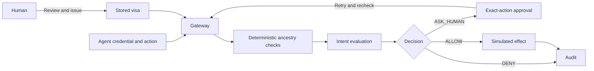

# Architecture

The gateway is an enforcement point. `/execute` authorizes an exact action and invokes the selected protected adapter (simulation by default), or atomically reserves and queues an opt-in mock payment. There is no public tool route that skips authorization. Agent identity comes from a server-side credential mapping, not a request field. Visas are opaque IDs referencing stored contracts.

| Module | Responsibility |
| --- | --- |
| `models.py` | Strict contracts/actions, domain-specific vocabularies and legacy drafting entry point |
| `domains/` | Registered procurement/research plugins: closed schemas, trusted metadata, preparation and intent |
| `domain_types.py` | Shared preparation and intent result interfaces |
| `policy_files.py` | Strict JSON compilation to ordinary exact-scope contracts |
| `tools.py` | Compatibility imports for the original procurement adapter |
| `policy.py` | Deterministic checks and delegation attenuation |
| `intent.py` | Domain-dispatched baseline and legacy evaluator imports |
| `semantic.py` | Optional remote review that cannot relax the baseline |
| `gateway.py` | Transactions, budgets, approvals, effects and audit |
| `execution/` | Optional Docker read-only backend, bounded worker and pinned-address HTTPS proxy |
| `outbox_store.py` | Transactional ancestor reservations, settlement and queued cancellation |
| `outbox.py` | Leased dispatch, current-authority rechecks and provider reconciliation |
| `mock_payments.py` | Independent durable mock provider with idempotency, lookup and cancellation fencing |
| `json_input.py` | Strict JSON validation before HTTP route processing |
| `api.py` | Credential separation, bounded HTTP bodies and operator routes |
| `storage.py` | Private POSIX database creation and preconnection file checks |
| `queries.py` | Bounded keyset reads, filters and exact approval inspection |
| `operator.py` | Human-only control client and exact-action review workflow |
| `transport.py` | Shared validation of trusted gateway origins |
| `mcp_server.py` | Agent-only stdio bridge to the same HTTP enforcement boundary |
| `evaluation.py` | Labeled regression runner and metrics |

## Transactions and retries

Execution acquires a SQLite `BEGIN IMMEDIATE` transaction. The gateway reads current ancestry, interprets arguments, checks policy, evaluates intent, writes the simulated effect, updates all ancestor usage and appends an audit record. After intent evaluation, the gateway checks every ancestor’s expiration again before permitting an effect or review. Existing review deadlines are also rechecked; a newly requested review is denied if evaluation consumed its five-minute window. Expired attempts are recorded as completed denials and require a new request ID. Failure rolls back the transaction. Concurrent writers serialize, preventing sibling agents from spending the same remaining budget.

Request IDs are scoped to the authenticated identity and bound to a canonical hash of the complete action, including context. Reusing an ID with different arguments is denied. Completed requests return stored results without another effect. A replayed successful response describes a previous execution, not a fresh authorization grant. Agent-only request-status reads expose the authenticated identity’s stored state and last response without executing or mutating anything. A missing result is only a snapshot observation and does not rule out an in-flight commit. Completed denials are also cached; use a new request ID after correcting an action.

Approvals expire at the earlier of five minutes or an ancestor's expiration. Approval alone does not execute anything. On retry, the gateway rechecks all current policy and semantic denial. Edits and revocations atomically invalidate pending and approved reviews across the affected subtree. A recursive query follows stored parent links; lifecycle audit events record the number of invalidated reviews. Sibling and unrelated branches remain unchanged. Completed results and rejected reviews retain their existing state. Hard denials cannot be approved. The operator CLI and HTTP API require the action fingerprint shown during inspection for both approval and rejection. The gateway atomically compares it with the stored request and records it with the review. Direct Python calls remain trusted internal interfaces and retain the optional argument for local demos and tests; they are not an authenticated security boundary.

## Delegation

Parent pointers preserve the full chain. Child allowed sets must be subsets; forbidden sets retain all parent restrictions. Budget, transaction limit, action count, approval threshold and expiration cannot increase. Depth decreases. Identity can change, while mission and canonical purpose remain the same.

Authority is shared rather than reserved when delegated. Specific authorized outbox payments reserve against every ancestor; that is per-action exposure, not a separate delegated budget. Multiple children can each have a nominal cap equal to the parent, but aggregate usage cannot exceed the parent's current cap. Descendants remain subject to later ancestor restrictions and revocation. Snapshot parent pointers allow reconstruction of the delegation graph.

## Audit and tradeoffs

Authorization records include principal, exact action, mission, ancestry, policy checks, intent diagnostics, cost, impact, decision, human intervention and latency. Lifecycle changes and human reviews are also recorded. HTTP authentication/schema failures occur before the engine and are not decision records; production deployments need separate redacted boundary logs.

The hash chain is locally verifiable, not tamper-proof. A database administrator can rewrite the chain or truncate its tail. Strong evidence requires externally anchored checkpoints and protected retention.

SQLite is a local single-host ledger. Semantic review currently holds the writer transaction; remote latency reduces throughput. Production should perform expensive review outside the critical section and then revalidate versioned policy and effect metadata before reserving authority.

Simulated effects are database records in the same transaction. Optional Docker reads happen after authorization inside that transaction; successful receipts and usage commit together, but a completed read cannot roll back and may repeat after commit failure. Docker writes remain disabled. The opt-in mock-payment domain now reserves budget and writes a PENDING outbox row in the authorization transaction. Its worker commits a revalidated dispatch/UNKNOWN state before calling the separate provider outside the ledger lock. Idempotency, lookup and fenced cancellation prevent duplicate charges or premature release in the tested mock. A timeout retains reservations; settlement converts/releases them atomically with the receipt and audit. This is not atomic rollback of an external effect or proof that an arbitrary real processor has those guarantees. See [outbox execution](outbox.md).

Operator list queries use read-only SQLite transactions and captured upper insertion bounds. They do not reserve the writer lock with BEGIN IMMEDIATE. In SQLite rollback-journal mode, an active read transaction can still delay a writer commit. Additive indexes are created on startup without rewriting existing audit events. See [pagination semantics](pagination.md).

## Domain selection and policy compilation

The stored canonical purpose selects a server-registered domain. Requests cannot
load modules or select an alternative adapter. Preparation is pure and effect-free;
all simulated effects still use the same transaction. Contracts validate tool and
resource vocabularies per domain; changing purpose requires a new visa. Existing
procurement contracts require no schema migration.

Policy deny globs expand to concrete forbidden sets at compilation. Denies win over
allows; existing exact-set checks and attenuation remain the enforcement path.
Research uses offline fixture reads and reviewed summary records, not host I/O.
See [domains and policy files](domains.md) for the compiler's bounds, defaults and
tradeoffs. The separate `sandbox_readonly` purpose enables real Docker reads only when the operator configures the backend. It never upgrades a simulation visa into real authority. See [read-only execution](sandbox-execution.md) for confinement, egress, deadlines and retry limits. The separate `mock_payment` purpose uses the Phase 4 outbox. Existing purposes retain their adapters; no simulation silently becomes a payment.

## External dispatch commitment and recovery

Queued payments are cancelled on subtree edits/revocation. Dispatched unknown work
retains its reservation, even after expiry, until authoritative reconciliation.
Caps cannot be lowered below committed plus uncertain reserved exposure. Revocation
cannot undo an already-dispatched provider call; the durable dispatch check is its
authorization commitment point. A recorded earlier success is accounted for even
if the visa has since expired. Absent operations are reauthorized before retry or
fenced at the provider before releasing funds. Lease expiry alone releases nothing.

The API's `decision` describes authorization. Outbox `execution_state` describes
PENDING, UNKNOWN, COMMITTED or FAILED, and `executed` becomes true only for a
confirmed commit. Provider identity and payload binding persist across restarts.
A worker or provider outage can leave exposure held indefinitely; monitoring and
provider-specific operational reconciliation remain required for real deployment.
