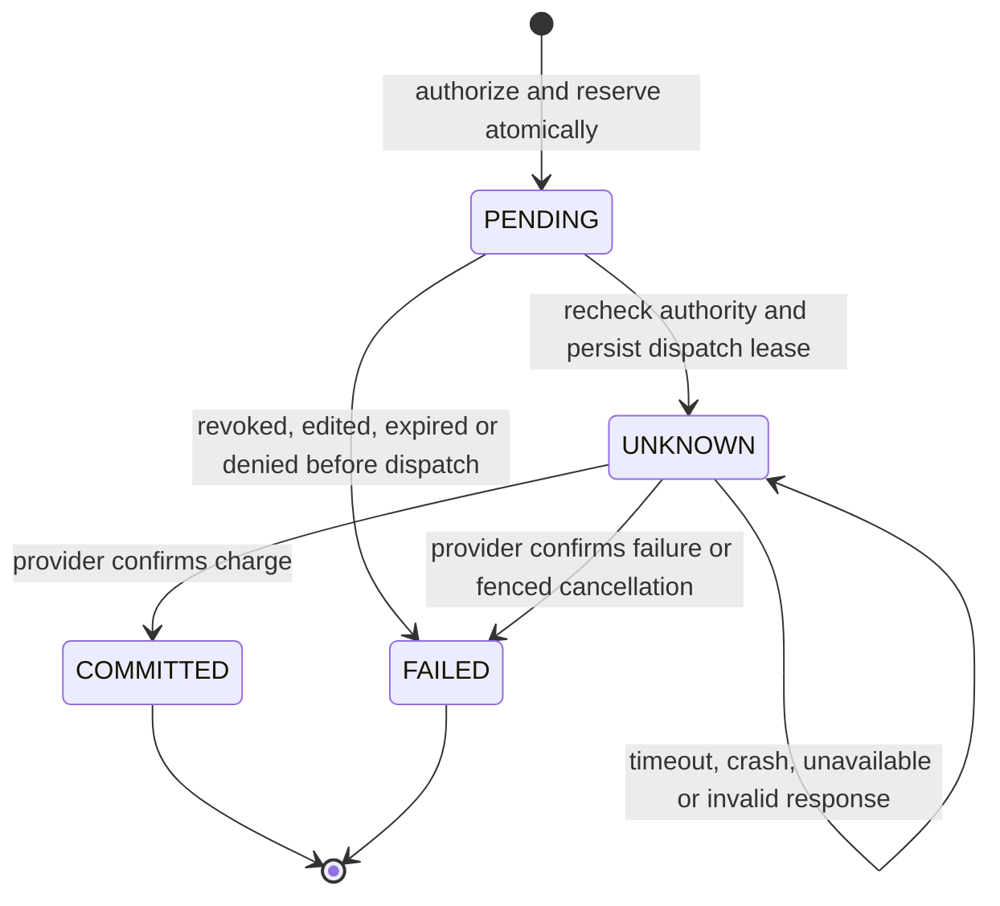

# Reservation and outbox execution

Phase 4 implements crash recovery using a **mock payment provider**, backed by a
separate SQLite database. No real payment processor, checkout, financial account,
or filesystem-write adapter is connected. The existing procurement/research demos
and Docker read-only tools retain their behavior. New `payments` missions use the
stored purpose `mock_payment`; they fail closed unless explicitly enabled.

## Authorize, reserve, dispatch, reconcile



`/execute` performs existing identity, full-ancestry policy, intent and exact-action
approval checks. An allowed payment inserts an outbox record with an immutable
payload, opaque idempotency key, provider-store identity and one reservation per
ancestor, in the same transaction as the request and authorization audit record.
No provider call occurs before that transaction commits.

Delegation itself still reserves nothing. Reservations are for **specific allowed
actions**, not separate copies of delegated spending money. For each ancestor:

```
available money = spending cap - committed spend - outstanding reserved money
available actions = action cap - committed actions - outstanding reserved actions
```

Every gateway authorization uses those effective quantities. A child's reservation
also counts against its parent and all higher ancestors. Settling one payment
converts its existing holds into spent/action counters at every ancestor exactly
once; a terminal failure releases them. A pending human review has no reservation.

The worker rechecks current ancestry, policy, trusted price/payload, intent, review
requirements and expiry before dispatch. It excludes only its own reservation from
this recheck, so it cannot count the same action twice or ignore a sibling's hold.
Changed trusted pricing fails closed rather than sending a different approved
payment. The dispatch audit, worker lease and `UNKNOWN` state commit before the
provider call, which runs **outside** the authorization-store transaction.

`UNKNOWN` deliberately includes an in-flight attempt. A process can die after the
provider succeeds and before Nodi receives or saves the result; recording uncertainty
before the call closes that crash window. A lease suppresses concurrent active
workers, but is not an exactly-once guarantee. Expired leases permit reconciliation,
not reservation release. Stale workers cannot settle a record claimed by a newer
worker. The provider's stable idempotency key prevents duplicate charges even if
both workers reach it.

On recovery, the reconciler queries the provider first:

- `COMMITTED`: record the confirmed receipt, consume reservations and audit settlement.
- `FAILED`: release reservations and record the terminal failure.
- `ABSENT`: recheck authority before retrying the **same** key. If authority is no
  longer valid, ask the provider to atomically fence/cancel that key before releasing.
- Unavailable or invalid result: retain `UNKNOWN` and all reservations; try later.

A not-found lookup alone is insufficient evidence to release a hold: an older
worker may still be about to call the provider. The mock's cancellation inserts a
permanent failed-key tombstone, or returns an already committed result. It races
atomically with charge creation, so a delayed charge cannot succeed after a confirmed
cancellation. A real provider lacking authoritative cancellation/fencing must retain
uncertainty rather than use this mock-specific shortcut.

## Edits, revocation and authorization timing

An edit or revocation cancels all **PENDING** outbox entries in the affected subtree
and releases their reservations in the same transaction. Already-dispatched
`UNKNOWN` work retains its holds. Caps cannot be lowered below committed plus
uncertain reserved exposure; otherwise a later confirmed charge could exceed a
newly lowered cap. The legacy behavior of administratively lowering a cap below
past spend when there are no holds is unchanged.

The dispatch transaction is the authorization commitment point for an external
operation. Revocation or expiry after dispatch cannot undo an operation already
accepted or in flight at the provider. Reconciliation accounts for an earlier
success even if its visa is now revoked; it does not issue fresh authority. An
absent payment is never newly retried under expired or revoked ancestry. This is
not a promise of instantaneous remote cancellation at the wall-clock revocation
instant. Returning a cached result is likewise not a new authorization.

Approval deadlines still bind dispatch to the exact action and expire within the
original review window. After a pending payment is cancelled or an authorization
fails, use a new request ID for a newly reviewed attempt; reusing the old ID returns
its stored state. Reusing an ID with changed arguments is always denied.

## API and MCP response semantics

For outbox payments, `decision: ALLOW` means **authorization**, not confirmed payment:

```json
{
  "decision": "ALLOW",
  "executed": false,
  "execution_state": "PENDING",
  "outbox_id": "<stable opaque operation ID>"
}
```

`execution_state` becomes `UNKNOWN`, `COMMITTED`, or `FAILED`. Only `COMMITTED`
sets `executed: true` and includes a receipt. A failed provider transaction can
retain `decision: ALLOW` because it was authorized but did not complete. The
receipt says `mock: true`, `simulation: false`, and `backend: mock-payment-outbox`:
this distinguishes an independent durable mock effect from the old atomic
simulation, not a real-money charge.

Poll the existing agent-only `/requests/status` endpoint or MCP
`get_request_status`; retrying identical `/execute` also returns the current stored
state without sending another payment. The outer request `state: completed` means
the **approval workflow** has finished, not that an outbox payment has settled.
Always inspect `last_response.execution_state` and `last_response.executed`.
Existing synchronous simulation responses do not gain an execution-state field.
The MCP bridge validates both response forms without treating queued work as success.

Administrator `/control` includes outbox/reservation rows when the mock provider is
configured; visa snapshots include reserved amounts and counts. Visa inspection
reports available limits after holds. Saved responses describe their recorded
snapshot; use fresh visa inspection for current balances. Outbox management is a
trusted local worker, not an agent-accessible route or new administrator shortcut.

## Run locally

Use the normal private configuration and append this field (retain credentials and
the gateway's existing `database`):

```json
{
  "mock_payments": {"database": "/absolute/private/path/mock-provider.db"}
}
```

The provider database must be distinct from the authorization ledger. Both use the
same owner-only file protections. Environment-factory users can set
`NODI_MOCK_PAYMENTS` to that one-field JSON object. The hosted public-demo factory
never enables it. No optional Python dependency or paid service is required.

```sh
python -m nodi serve
python -m nodi policy explain examples/policies/payments.json --agent procurement
```

Review the output `contract`, save that object to `reviewed-contract.json`, and issue
it with the existing administrator workflow:

```sh
python -m nodi.operator --config .nodi.local.json issue --contract reviewed-contract.json
```

The agent credential must map to the contract's identity. Submit a `purchase` to
`/execute` using resource `vendor:approved` and arguments
`{"product_id":"monitor-basic","quantity":1}`. Human review still applies to a
higher-cost purchase such as `monitor-pro` under the example policy. No fault mode,
price, provider URL, or provider idempotency key is accepted from an agent.

Run a bounded worker pass, then poll request status:

```sh
python -m nodi.outbox --config .nodi.local.json --limit 20
```

The CLI handles up to the specified number of ready deliveries/reconciliations and
exits; it is not an automatically running background service. Run it again after
an unknown outcome's retry delay or expired lease. It uses the same semantic-service
configuration as the API. Configured defaults are a 30-second worker lease and a
five-second retry delay. No provider operation occurs if the provider is disabled.

A self-contained recovery demonstration, requiring no credentials or configuration:

```sh
python -m nodi.outbox_demo
```

It uses temporary independent stores, loses a success response, reconciles, and
prints observed states/call counts/reservations. The underlying mock's trusted
`set_mode(mode, key='*')` API supports `success`, `fail`, `timeout`, `lose_response`
and `unavailable`; these controls are for local tests and are not HTTP agent tools.
A terminal key retains its original outcome even if the fault mode later changes.

## Recovery and limits

Provider idempotency binds a key to the complete payment payload and persists
success/failure records indefinitely in this mock. Reusing a key with a changed
payload is rejected. The provider identity is recorded in every outbox row; startup
and workers refuse a replacement/empty provider store while unresolved entries
exist. Restore the original store and reconcile instead of generating replacement
keys. Preserve both stores and their histories when backing up or recovering them;
this design does not recover data erased from both the ledger and provider history.

No ambiguous timeout is reported as a confirmed failure, and reservations are not
automatically freed by expiry. An unavailable provider can therefore leave funds
held indefinitely. That is retained exposure, not permission to spend the same
money again. Production recovery would need operational monitoring, provider-specific
lookup/cancellation guarantees, retention contracts and reconciliation procedures.
This phase proves those transitions with a durable mock; it does not certify an
arbitrary external processor. Docker writes and real checkout remain disabled.

## Reproducible validation

```sh
HYPOTHESIS_PROFILE=nodi-ci python -m pytest -q
python -m pytest -q tests/test_outbox.py tests/test_outbox_invariants.py
python -m nodi.outbox_demo
python -m nodi evaluate
python -m nodi evaluate --domain research
python -m nodi demo
```

Fault tests terminate actual subprocesses after reserve, after claim, after provider
success and during local settlement, then reopen both stores and reconcile. Other
tests cover duplicate delivery, sibling reservation races, retry storms, stale
workers, cancellation fencing, malformed results, audit failures, wrong provider
identity, approval expiry and subtree edits. Generated sequences compare the
independent provider charge history against ancestor spend plus reservations and
verify dispatch authority against reconstructed lifecycle history.

The tests assert that terminal rows have no holds and unresolved rows retain exactly
their ancestor holds; successful reconciliation releases/converts them without a
second charge. These are bounded regression and fault tests, not independently
sampled production failures. No population reliability rate or statistical confidence
interval is inferred. CI runs them and verifies the recovery demo from an installed
wheel outside the source checkout.

## Separate HTTP boundary validation

The controlled service in `benchmarks/recovery` owns a different durable database
in a separate process. Authorization and ancestor reservation commit together as
PENDING. A worker rechecks current policy, records dispatch authorization and marks
UNKNOWN before HTTP dispatch. The service commits an idempotent effect independently;
its HTTP response is acknowledgement, **not** gateway completion. Only a validated,
payload-bound receipt plus atomic ledger settlement converts reservations into spend
and records COMMITTED. A local settlement crash rolls that transaction back.

Recovery retains UNKNOWN holds and queries the original service identity. A terminal
receipt settles once; ABSENT requires fresh dispatch authorization or a durable
cancellation fence before releasing funds. Lease ownership prevents a stale worker
from settling a newer worker's claim, while service idempotency handles overlapping
HTTP requests. Revocation/expiry prevents new dispatch authority, not completion of
already authorized in-flight work. An already committed service effect is reconciled
even after revocation; it is never relabeled FAILED merely to release its budget.

Tests kill the gateway before dispatch, after acknowledgement and during settlement,
and kill the service after its durable effect but before acknowledgement. They also
exercise overlapping expired leases, concurrent reservation/worker contention,
retries, expiry/revocation, late-charge cancellation fencing and ancestor conservation.
The service assumes durable storage survives process death (not disk loss), permanent
payload-bound idempotency, authoritative lookup and atomic cancellation. This adds
network-boundary evidence to the existing simulated design; SQLite atomicity alone
does not establish external atomicity or verify a third-party integration.
