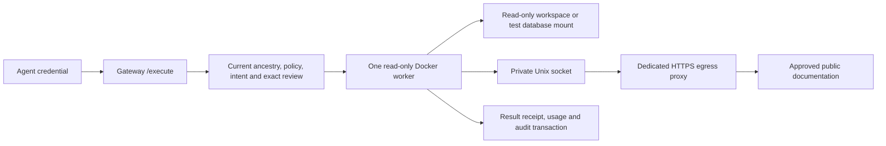

# Optional Docker read-only execution

Phase 3 adds a separate `sandbox` domain (`sandbox_readonly` stored purpose).
The default gateway, existing procurement/research contracts, and public browser
sandbox remain simulations. An existing simulated visa never starts doing real I/O
when Docker is enabled. Real-domain requests fail closed when the backend is absent.

**No real writes are implemented.** Phase 4's reservation/outbox and reconciliation
are prerequisites for effects that cannot roll back. There is no payment, file-write,
SQL mutation, arbitrary command, or general browsing endpoint in this backend.

## Execution boundary



The backend runs only after the full ancestry passes enforcement. File and database
reads require exact-action human approval because read access can expose sensitive
information. Approval cannot bypass scope, revocation, expiry or action limits.
Tools derive resources from validated arguments, never the claimed resource string.
The worker validates the arguments again and checks expiry before reading. A bounded
worker alarm and a post-read expiry check prevent release of late results. These
checks cannot undo a GET already received by a remote server.

The only supported agent interface is authenticated `/execute`, including through
the existing MCP bridge. The worker has no listening HTTP service. Python methods,
Docker access and the proxy socket are trusted internal interfaces, not independent
authentication boundaries. Agents must not have the gateway's host, Docker socket,
volume access, or credentials permitting direct access to protected data.

## Available tools

| Tool | Arguments | Derived resource and restrictions |
| --- | --- | --- |
| `filesystem.read` | `path` | `workspace:research`; relative UTF-8 file within the dedicated workspace |
| `http.get` | `url` | `web:docs.python.org` or `web:www.sqlite.org`; exact HTTPS documentation paths |
| `sqlite.query` | `query` | `database:test`; one SELECT against the `articles` table in the dedicated `test.db` |
| `shell.read` | `command` | `runtime:info`; `system` runs `/usr/bin/uname -s`, `date` runs `/usr/bin/date -u +%Y-%m-%d` |

A workspace scope grants reads of that whole mounted directory, not per-file
permissions. Mount only data the mission may read; do not use your home directory,
repository, credential directory, or authorization ledger as the workspace.
Human review is an additional check, not a replacement for minimizing the mount.

Paths are bounded ASCII relative names. Absolute paths, hidden components, empty
components, dot/dot-dot, backslashes and encoded path syntax are rejected.
Directory traversal uses held directory descriptors and `O_NOFOLLOW` for every
component. Final files must be regular, single-link and within the size bound;
symlinks, hard links, devices and FIFOs are refused. Host mount roots must be
canonical absolute directories controlled by the operator. Protect their ancestors
and contents from concurrent untrusted host changes; this does not sandbox a hostile
host administrator or kernel.

The database is a bounded snapshot of `test.db`, read using the same descriptor
checks and deserialized into memory. SQLite query-only mode and an authorizer allow
SELECT, reads of `main.articles`, and only `count`, `length`, `lower`, and `upper`
functions. Other tables, schema reads, pragmas, attachments, extension loading,
multiple statements and mutations fail. Rows, instructions, input and output are
bounded. Only the operator prepares this test database; the gateway never mounts its
own ledger. No command string is passed to a shell, and command arguments are fixed.

## Container and egress controls

Workers use an immutable local image ID with pulling disabled, a read-only root,
UID/GID 65532, all capabilities dropped, `no-new-privileges`, Docker's default seccomp
profile, and `--network=none`. Only the mount needed by that tool is provided, read-only.
They receive no agent, administrator or provider secrets and no Docker socket.
Configured limits are half a CPU, 128 MiB memory (no extra swap), 16 processes, 64 file
descriptors, and no core dumps. The worker has a ten-second wall-clock alarm; the
host allows fifteen seconds for Docker startup/execution and force-removes the
container on completion or timeout. Cleanup itself has a bounded wait. Losing the
Docker daemon can prevent host cleanup; the independent worker alarm still applies.

The separate proxy has network access and listens only on a private Unix socket in
a Docker volume shared with HTTP workers. No port is published. Thus workers have
no IP route even to a gateway or host service. The proxy accepts only GETs to exact
paths in the reviewed host/path map in `execution/validation.py`; there are no query
parameters, custom headers, cookies, credentials or arbitrary ports. Restricting
paths as well as domains also avoids an arbitrary query-string exfiltration channel.

The proxy resolves DNS itself, rejects the entire answer if any address is nonpublic,
multicast, mapped or a supported transition address, then connects to one checked
numeric address with TLS hostname verification and SNI for the original host. There
is no second DNS lookup or redirect following. Proxy environment variables are not
used. DNS resolution and the whole GET are enclosed by a child-process deadline.
Responses are bounded, uncompressed UTF-8; large or unavailable pages fail rather
than silently truncating. The trusted proxy and reviewed image are security-critical.

Control references: [Docker runtime constraints](https://docs.docker.com/engine/containers/run/)
and [SQLite authorizer API](https://docs.python.org/3.11/library/sqlite3.html#sqlite3.Connection.set_authorizer).
These controls reduce exposure; they are not proof against container/kernel exploits.

## Local setup

Requires a working local Docker Engine/Desktop, Docker Compose, and the existing
Python installation. Native Windows paths and remote Docker daemons are unsupported.
No extra Python dependencies are needed. This is an operator setup, not a change to
the free Render demo (which cannot launch these Docker workers).

From the repository:

```sh
python scripts/init_research_workspace.py ./research-data
docker compose -f docker/compose.sandbox.yml up -d --build --wait
docker image inspect nodi-readonly:local --format '{{.Id}}'
```

The initialization script refuses existing directories and creates nonsecret sample
data. Keep the workspace/database roots on the local Docker host. The base image is
pinned by digest; review and update it periodically. After rebuilding, refresh the
configured worker image ID and restart the gateway so worker and proxy use reviewed code.

Run `python -m nodi init` if you do not already have a private configuration. Add this
`sandbox` field to that configuration, replacing the image and absolute directory paths:

```json
{
  "sandbox": {
    "image": "sha256:<image ID returned by docker inspect>",
    "workspace": "/absolute/path/Nodi/research-data/workspace",
    "database": "/absolute/path/Nodi/research-data/database",
    "egress_volume": "nodi-egress-local"
  }
}
```

Retain the existing `admin_token`, `agent_tokens`, and `database` fields. The snippet
is only the additional field, not a complete configuration. Then `python -m nodi serve`
uses the configured backend. For the environment-based factory, `NODI_SANDBOX` accepts
the same four-field JSON object. Unknown backend configuration fields are rejected.
`/health` reports `simulation+sandbox-readonly`; it is a mode indicator, not a Docker
or proxy readiness guarantee. The public hosted factory never enables this backend.

Compile and inspect the example policy:

```sh
python -m nodi policy explain examples/policies/sandbox.json --agent procurement
```

Use an identity already mapped to a server-side agent credential (`procurement` is
the default local configuration). Extract and review the `contract` object, then
issue it using the existing administrator workflow:

```sh
python -m nodi.operator --config .nodi.local.json issue --contract reviewed-contract.json
```

An agent can submit, for example, the following to `/execute` with its bearer token:

```json
{
  "request_id": "research-read-1",
  "visa_id": "<issued visa ID>",
  "tool": "filesystem.read",
  "resource": "workspace:research",
  "arguments": {"path": "source.txt"}
}
```

This asks for human review. Inspect/approve through the existing operator commands,
then retry the identical action and request ID. The response is marked
`simulation: false` and `backend: docker-readonly`. `shell.read` with `{"command":"system"}`
and resource `runtime:info` exercises a bounded read without an approval step.
The website's public scenario remains simulated; there is no real-tool browser UI.

## Transaction and retry limits

Read execution still holds the SQLite writer transaction, so a slow container or
GET serializes other writers. The worker performs no durable tool mutations. A
successful read receipt, action counters and audit entry commit together. Completed
request replay returns the original stored result without another read. Shared
ancestor action limits and budgets still apply; these reads have zero monetary cost.

A runtime error returns HTTP 503 with no fabricated ALLOW, no result receipt and no
committed usage. Audit/commit failure likewise rolls back the receipt and usage,
but cannot undo a completed read. Retrying the same request after such failure may
repeat it. GETs may leave access logs or trigger behavior on a misconfigured server;
only reviewed static documentation destinations are permitted. No exactly-once or
atomic-external-execution claim is made. The implementation does not reserve budget,
retry unknown irreversible outcomes or provide the Phase 4 outbox.

## Reproducible checks

```sh
HYPOTHESIS_PROFILE=nodi-ci python -m pytest -q
python -m nodi evaluate
python -m nodi evaluate --domain research
python -m nodi demo
export NODI_TEST_SANDBOX_IMAGE=$(docker image inspect nodi-readonly:local --format '{{.Id}}')
python -m pytest -q tests/integration/test_docker_readonly.py
NODI_TEST_PUBLIC_HTTP=1 python -m pytest -q tests/integration/test_docker_readonly.py
```

The normal suite skips real-container tests unless the image ID is explicitly set.
CI builds the image and runs the container checks in a separate job. The public HTTPS
smoke test is separately opt-in because the external site may be unavailable. It
verifies an actual response, not a fixture, and a failure is not silently skipped.
Tests cover successful reads via authenticated HTTP and approval, replay, denied
writes/escapes, SQL rejection, no outbound route, read-only mounts, nonroot UID,
capability removal, privilege restrictions, resource limits and proxy rejection.
Unit tests also exercise mixed DNS answers, redirects, limits and gateway failure
semantics. These are regression checks, not independently sampled attacks; no
population success rate or statistically meaningful confidence interval is claimed.

Stop the local proxy when finished:

```sh
docker compose -f docker/compose.sandbox.yml down --volumes
```

This removes the proxy/socket volume, not the research data or authorization ledger.
